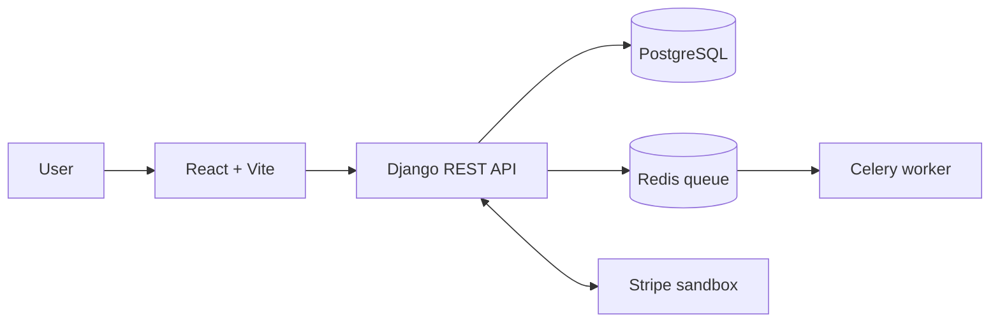

# Multi-Tenant SaaS Project Management Platform

A full-stack project management platform where multiple organizations can work in separate tenant workspaces. Each workspace has its own boards, sprints, tasks, members, and subscription status.

**GitHub repository:** [multi-tenant-saas](https://github.com/pillakarthik2002-maker/multi-tenant-saas)

## Features

- Tenant-isolated workspaces with Owner, Admin, Member, and Viewer roles
- Boards, sprints, and Kanban task statuses
- Task descriptions, priorities, and drag-and-drop status changes
- Task comments and file attachments
- Audit events for important actions
- Role-based custom workflows
- Asynchronous weekly reports using Celery and Redis
- Stripe subscription checkout and webhook handling in **test mode**
- Free plan limits of one board and ten tasks; active Pro workspaces have higher limits
- Docker Compose setup for the API, frontend, database, Redis, and background worker
- GitHub Actions continuous integration

## Technology stack

- **Frontend:** React and Vite
- **Backend:** Python and Django REST Framework
- **Database:** PostgreSQL
- **Background jobs:** Celery and Redis
- **Payments:** Stripe test mode
- **Containers:** Docker Compose
- **CI:** GitHub Actions

## Architecture



The frontend sends authenticated requests to the Django API. Requests include a tenant ID, and the API checks the signed-in user’s membership before returning or changing tenant data. Celery uses Redis to process weekly report jobs in the background.

## Run locally with Docker

### Prerequisites

- Git
- Docker Desktop with Docker Compose

### Setup

1. Clone the repository:

   ```text
   git clone https://github.com/pillakarthik2002-maker/multi-tenant-saas.git
   cd multi-tenant-saas
   ```

2. Create a local `.env` file in the project root. Set the required values for your environment, including Django and Stripe test credentials, according to `docker-compose.yml`.

   **Never commit or share `.env` or real secret keys.** The repository’s `.gitignore` excludes `.env`.

3. Build and start the services:

   ```text
   docker compose up --build -d
   ```

4. Apply database migrations:

   ```text
   docker compose exec api python manage.py migrate
   ```

5. Create a Django administrator account if one does not already exist:

   ```text
   docker compose exec api python manage.py createsuperuser
   ```

6. Open the application:

   - Frontend: [http://localhost:5173](http://localhost:5173)
   - Django Admin: [http://localhost:8000/admin/](http://localhost:8000/admin/)
   - Health endpoint: [http://localhost:8000/api/health/](http://localhost:8000/api/health/)

Use Django Admin to create tenants, users, and memberships. A user needs a membership in a tenant to access that workspace. Sign in to the frontend with the user’s Django username and password, and enter the tenant ID.

### Useful Docker commands

View running services:

```text
docker compose ps
```

View API logs:

```text
docker compose logs --tail=50 api
```

View background worker logs:

```text
docker compose logs --tail=50 worker
```

Stop the services:

```text
docker compose down
```

## Stripe test mode

Billing is configured for Stripe **sandbox/test mode**. Set the Stripe test secret and webhook secret in your local `.env` file. Do not put secret values in this README or in the submitted Drive folder.

To forward test webhook events locally, run Stripe CLI in a separate terminal:

```text
stripe listen --events checkout.session.completed,customer.subscription.created,customer.subscription.updated,customer.subscription.deleted --forward-to http://localhost:8000/api/billing/webhook/
```

Keep the listener running while testing checkout. Production billing requires separate production credentials and deployment configuration.

## API overview

Authenticated API requests use a token and the `X-Tenant-ID` header.

| Endpoint | Purpose |
|---|---|
| `GET /api/health/` | Check API health |
| `POST /api/token/` | Obtain an authentication token |
| `GET /api/workspace/` | Get the current workspace |
| `/api/boards/` | List or create boards |
| `/api/sprints/` | List or create sprints |
| `/api/tasks/` | List or create tasks |
| `/api/tasks/<id>/` | Read, update, or delete a task |
| `/api/tasks/<id>/comments/` | List or add task comments |
| `/api/tasks/<id>/attachments/` | List or upload task attachments |
| `/api/audit/` | View workspace audit events |
| `/api/workflows/` | List or create custom workflows |
| `POST /api/reports/weekly/` | Queue a weekly report |
| `POST /api/billing/checkout/` | Start Stripe test checkout |
| `GET /api/billing/status/` | View workspace subscription status |
| `POST /api/billing/webhook/` | Receive Stripe webhook events |

## Roles

- **Owner:** Manages the workspace and its billing.
- **Admin:** Manages workspace settings and workflows.
- **Member:** Works with boards and tasks.
- **Viewer:** Can view workspace content but cannot make changes.

Django superuser access is separate from workspace roles and is intended for site administration.

## Validation performed

During development:

- Django’s system check completed with no issues.
- The latest GitHub Actions workflow passed.
- Stripe sandbox checkout and webhook delivery were verified.
- A Celery weekly report job completed successfully.

These checks support a development demo; they do not represent production deployment or a full automated test suite.

## Project status and limitations

This project is intended as a development and demonstration build. Stripe is in test mode, and Django is configured for local development. Production use would require deployment hardening, production secrets, HTTPS, persistent storage, and broader automated security and tenant-isolation tests.
